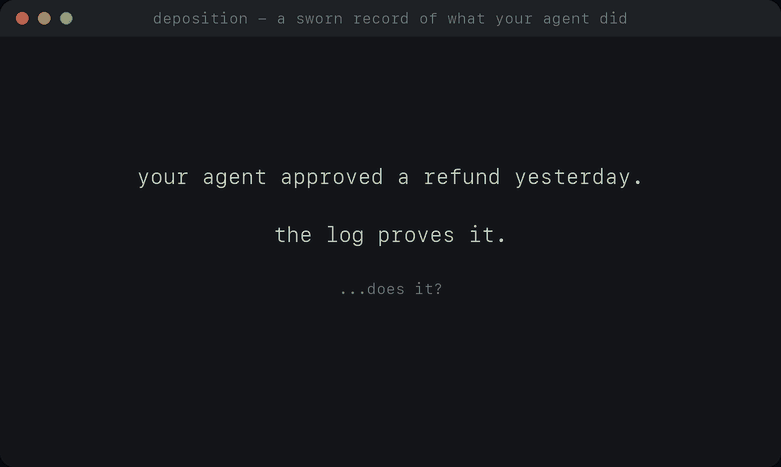

# Deposition

[](https://github.com/chiragrajputuss-code/deposition/actions/workflows/ci.yml)
[](https://pypi.org/project/deposition/)
[](https://pypi.org/project/deposition/)
[](LICENSE)

Tool capture verified against real packages, not self-reported — see
[the harness](#tool-capture-verified-against-real-frameworks):

[](docs/decisions/012-tool-capture-shipped.md)
[](docs/decisions/012-tool-capture-shipped.md)
[](docs/decisions/012-tool-capture-shipped.md)
[](docs/decisions/012-tool-capture-shipped.md)
[](docs/decisions/012-tool-capture-shipped.md)

**A sworn record of what your AI agent actually did.**



*A deposition is sworn testimony, recorded verbatim outside a courtroom and used
as evidence when someone later disputes what happened. That is the idea.*

Deposition records every LLM call, tool call and decision your agent makes into a
tamper-evident, hash-chained trace, then replays that run step by step so you can
see exactly what happened and why.

It is not a metrics dashboard. LangSmith, Langfuse and AgentOps already own that
ground. Deposition's wedge is **replay + tamper-evidence + root cause**: a record
that cannot be altered behind your back, and a causal chain that answers *why did
the agent do that?*

None of the pieces here are inventions. Hash chains, signatures and provenance
tracking are old ideas with living neighbours, and the
[architecture decisions](docs/decisions/) cite them. What this project commits to
is a posture: never in your agent's hot path, never a probabilistic judgment
sealed as fact, never one green light where four separate claims belong — and
independent of every party it records.

## Try it now

No API key, no account, no config - a bundled run opens straight in the viewer:

```console
$ pip install 'deposition[viewer]'
$ deposition demo
```

It is a real recorded run, not a mockup: an agent asked to summarise a vendor
report gets prompt-injected by content inside that report, and Deposition shows
exactly what happened - the chain stays intact, the signature still verifies,
the record is complete, and it still catches a mandate violation, because
"nothing was altered" and "it stayed inside its authority" are different claims.
Three episodes, a tool-call causal chain to walk backwards, a mutation, a
failure, one real catch. Nothing it shows is staged after the fact - see
[`scripts/generate_demo_trace.py`](scripts/generate_demo_trace.py) for exactly
how it was produced.

```python
import deposition

deposition.init(project="support-triage")

@deposition.record(name="triage-agent")
def run_agent(ticket):
    # OpenAI and Anthropic calls are recorded automatically - request, response,
    # token usage and latency - with no logging code in your agent.
    response = client.messages.create(model="claude-sonnet-5", messages=[...])

    for block in response.content:
        if block.type == "tool_use":
            # No caused_by needed: Deposition saw the model ask for this tool.
            with deposition.step("tool_call", tool=block.name) as body:
                body["result"] = run_tool(block.name, block.input)
```

```console
$ depo verify ./deposition/run_9f3kQ2.jsonl
OK  42 events verified for run_9f3kQ2

$ depo view ./deposition/run_9f3kQ2.jsonl
serving replay viewer on http://127.0.0.1:7878
```

## Status

Pre-release, building in the open. Everything below is implemented and tested
(317 tests) against real agent frameworks, with an independent ground-truth
harness rather than self-report.

| Piece | State |
| --- | --- |
| Trace schema v1.0 — RFC 8785 canonical JSON | done — [ADR 008](docs/decisions/008-canonical-json.md) |
| Hash chain (build + verify) | done |
| Ed25519 signing | done — `[signing]` extra |
| Mandates + `deposition audit` | done — [ADR 010](docs/decisions/010-mandates.md) |
| Argument provenance (injection forensics) | done — prior art cited, [ADR 011](docs/decisions/011-claims-policy.md) |
| Claude Code importer + live tail | done — see [Importing Claude Code](#importing-claude-code) |
| Local `.jsonl` recording, blob externalisation | done |
| CLI (`demo` / `view` / `verify` / `audit` / `diff` / `keygen` / `import` / `tail`) | done |
| Local replay viewer, four-claim trust panel | done |
| OpenAI / Anthropic auto-instrumentation | done (non-streaming) |
| Streaming capture | not yet — request recorded, response is not |
| Countersigning at ingest | Phase 2 — [ADR 005](docs/decisions/005-signing-and-anchoring.md) |
| Interlocking traces (agent-to-agent) | proposed — [ADR 009](docs/decisions/009-interlocking-traces.md) |

## Current limitations

Said here plainly, not left for someone to discover by filing an issue.

**Streaming content is not captured.** `client.messages.create(..., stream=True)`
and `client.chat.completions.create(..., stream=True)` are instrumented, but
capturing the content would mean consuming or proxying the caller's own stream
object, and the standing rule — recording must never break the host agent —
outranks completeness. The call is still recorded, honestly incomplete: the
request is there, and the response is a declared marker,
`{"streamed": true, "captured": false}`, never a silently empty field. The same
is true of `anthropic.messages.stream()`, the context-manager streaming API,
which otherwise would have left **no event at all** — Deposition patches the
call itself, records the request at that point (before any network I/O), and
hands back the manager completely untouched, never entering it.

This is not swept into "no known gaps" either. A trace with a streamed call
reports `completeness.status: "streamed"`, distinct from an accidental drop,
and the viewer flags it as a moment — because a declared limitation that quietly
stops being declared, three versions later, is exactly the failure this project
exists to catch in *other* people's records.

**Tool-call capture is per framework, not universal.** Model calls are captured
for anything built on the OpenAI or Anthropic SDKs; the causal edge from a tool
call back to the model turn that asked for it needs one verified hook per
framework — see [Tool capture](#tool-capture-verified-against-real-frameworks)
for exactly which five, and which still have no hook at all.

**Signing has the limits stated in [Signing](#signing):** a key on the same
disk as the traces it signs raises the bar, it does not settle the question, and
nothing proves *when* a run happened beyond what the signer asserts. Both are
what [countersigning at ingest](docs/decisions/005-signing-and-anchoring.md)
exists to fix, and it is not built.

**Interlocking traces between two agents** — so each side's chain commits to
the other's at the moment they interact — is a written spec,
[ADR 009](docs/decisions/009-interlocking-traces.md), not shipped code.

## Tool capture: verified against real frameworks

Model calls are captured by instrumenting the OpenAI and Anthropic SDKs
directly, so anything built on them is covered automatically. Tool calls and
the causal edge between them need one hook per framework, because each
framework funnels tool execution through its own internal method - so this is
re-verified against the real package, not assumed from the docs, using an
independent ground-truth harness: a stub model server plus a spy wrapped
around the tool function, counting what actually happened outside Deposition
entirely.

Last verified 2026-10-17, against the current release of each package:

| Framework | Version tested | Model calls | Tools + causal edge |
| --- | --- | --- | --- |
| [LangGraph](https://github.com/langchain-ai/langgraph) / LangChain | 1.2.16 (`langchain-core` 1.6.12) | yes | yes |
| [CrewAI](https://github.com/crewAIInc/crewAI) | 1.15.28 | yes | yes |
| [OpenAI Agents SDK](https://github.com/openai/openai-agents-python) | 0.24.0 | yes | yes |
| [Pydantic AI](https://github.com/pydantic/pydantic-ai) | 2.57.0 | yes | yes |
| [AutoGen](https://github.com/microsoft/autogen) | 0.7.5 | yes | yes |
| smolagents, aider, anything on litellm | - | yes | model calls only |

The hook points are not stable across versions by nature - two have already
moved underneath this project. Pydantic AI's inviting-looking `handle_call` has
never been the real path; the actual one is `execute_tool_call`, found by
spying on every candidate rather than trusting the method name. LangGraph's
`langgraph.prebuilt.create_react_agent` is deprecated as of 1.x and removed in
2.0 in favour of `langchain.agents.create_agent` - the harness follows it so
the compatibility claim keeps meaning something instead of quietly describing
a version nobody runs anymore.

## Install

```console
pip install deposition             # SDK + the `depo` CLI
pip install 'deposition[viewer]'   # adds the local replay viewer
pip install 'deposition[signing]'  # adds Ed25519 signing
```

Or clone and install editable, which is what you want if you plan to read the
code - and reading the code is the point of an evidence tool:

```console
git clone https://github.com/chiragrajputuss-code/deposition.git
cd deposition
pip install -e '.[viewer,signing]'
python examples/04_refund_dispute.py
deposition verify ./deposition/run_*.jsonl --pubkey ./deposition/refunds.pem.pub
```

Python 3.10+. The SDK itself has **zero** required dependencies - heavy deps kill
adoption, and a recorder you cannot install is a recorder that records nothing.
`viewer` adds FastAPI; `signing` adds `cryptography`. Neither is needed to record.

Published as `0.1.0.dev0` while the API settles: pre-release, so `pip install
deposition` gives you it only because no stable release exists yet, and nothing
pins to it by accident.

## How it works

One run is one append-only event log. Each line of the `.jsonl` file is one
event, and each event's hash covers the previous event's hash:

```json
{"v":"1.0","run_id":"run_9f3kQ2","seq":14,"ts":"2026-09-27T08:14:03.412Z",
 "type":"tool_call","body":{...},"prev_hash":"9c41…","hash":"e7f2…"}
```

Edit an event, drop one, or reorder two, and `deposition verify` names the first
event where the trace stopped being trustworthy. Hashing is over [RFC 8785](https://www.rfc-editor.org/rfc/rfc8785)
canonical JSON, so a verifier in any language, including one running in a
browser, computes the same bytes and the same hash. The test suite cross-checks
this against a live Node process, including 400 randomly generated doubles.

**What that proves, precisely.** On its own the chain detects corruption and
alteration by anyone who does not hold the trace file. It does not stop someone
who does: they can edit an event and re-seal the rest into a chain that verifies
perfectly. That is what signing is for.

## Signing

```console
$ depo keygen --out signing.pem
private key  signing.pem  (keep this secret, mode 0600)
public key   signing.pem.pub
             4200424479dac722d3a8667b6696dfd3c6fa524ce17424390200c401d4822137
```

```python
deposition.init("support-triage", signing_key="signing.pem")
```

Each run then writes `run_9f3kQ2.sig` beside its trace: an Ed25519 signature over
the chain's head hash. Re-sealing an edited trace changes that head, and the
forger cannot sign the new one.

```console
$ depo verify run_9f3kQ2.jsonl --pubkey signing.pem.pub
OK  42 events verified for run_9f3kQ2
  OK signature: signature verified against 4200424479da...
```

**Pin the key or the signature proves nothing.** The `.sig` file carries the
public key it was signed with, so anyone who rewrites the trace can sign their
version with a key of their own and replace that field. Without `--pubkey`,
`verify` says *signed by an unverified key* and means it. The key has to reach
the verifier by a route the trace did not travel.

A signature checks out only against the head of the trace it was made for, so it
catches the edit-and-reseal the chain cannot:

```console
$ depo verify run_9f3kQ2.jsonl --pubkey signing.pem.pub
OK  42 events verified for run_9f3kQ2
  !! signature: signature covers head 9ce059683c05... but this trace ends at
     e36ebb6fc31b... - the trace was rewritten after it was signed
```

`verify` exits non-zero on a signature that fails, and `--require-signature`
makes an unsigned or unpinned trace a failure too — the flag to use in CI.

**The honest limits.** A key stored on the same disk as the traces it signs
raises the bar; it does not settle the question. Nor does a signature prove
*when* a run happened: `signed_at` is asserted by the signer. Countersigning at
ingest, where the server holds a key you do not, is the real answer, and it is
Phase 2 — see [ADR 005](docs/decisions/005-signing-and-anchoring.md). Deposition
says *tamper-evident* today, and will not say *tamper-proof* until that ships.

Any event may carry `caused_by: [seq, …]` pointing at the earlier events that
produced it. The SDK fills this in where it can — a tool call caused by the LLM
message that requested it — and the viewer walks it backwards to answer "why did
this happen?".

## Importing Claude Code

Claude Code already records what it did — every model turn, every `Bash`
command, every file write — as JSONL under `~/.claude/projects/`. What it does
not give you is a record anyone can check: the file is plain, mutable JSON, so
"the agent ran this command against my repo" is an assertion by whoever holds
the file.

`deposition import claude-code` reads that transcript and rebuilds it as a
hash-chained trace — verifiable, signable, and readable in the viewer above.
With no path given, it finds the newest session Claude Code has recorded for
the current directory on its own:

```console
$ deposition import claude-code
imported /Users/you/.claude/projects/-Users-you-myrepo/a1b2c3d4-….jsonl
  -> ./deposition/run_a1b2c3.jsonl  (238 events)

  deposition verify ./deposition/run_a1b2c3.jsonl
  deposition view   ./deposition/run_a1b2c3.jsonl
```

Every `Bash`, `Write`, `Edit` and `NotebookEdit` call is flagged
`mutates_environment: true` in its body, and each one carries `caused_by`
pointing at the model turn that asked for it — so "what did the agent actually
change" and "why did it do that" are both one `deposition view` away, not a
transcript to read by hand. Pass `--sign KEY.pem` to sign the imported trace
the same way a live one is signed.

`deposition tail claude-code` does the same conversion continuously, so
`deposition view --no-browser` on its output shows a session as it happens
rather than after it ends — see [example 14](examples/14_claude_code_session.py).

**The honest grade.** This is an import, not a live recording. The source file
was plain and mutable right up until the moment it was read, so the chain it
produces attests "unchanged since the last import" — a window of seconds for
`tail`, however long the session sat on disk first for a one-shot `import`. An
evidence-grade version records at the moment of each tool call, through Claude
Code's own hooks, and is a separate piece of work this command does not
attempt.

## Privacy

Your prompts are your data. `deposition.init(redact=...)` runs on every event
body **before** anything is hashed or written to disk:

```python
deposition.init(project="support-triage", redact=strip_pii)
```

In local mode nothing leaves your machine at all.

## Documentation

- [Trace schema](docs/decisions/002-schema-v0.md) and its [v1 canonicalisation](docs/decisions/008-canonical-json.md)
- [Architecture decisions](docs/decisions/)
- [Examples](examples/) — 14 runnable agents, including a disputed refund, a
  regulated credit denial, a prompt-injection incident, a multi-agent handoff and
  a GDPR erasure. All but two run with no API key and no network.

## License

Apache 2.0 — see [LICENSE](LICENSE).
